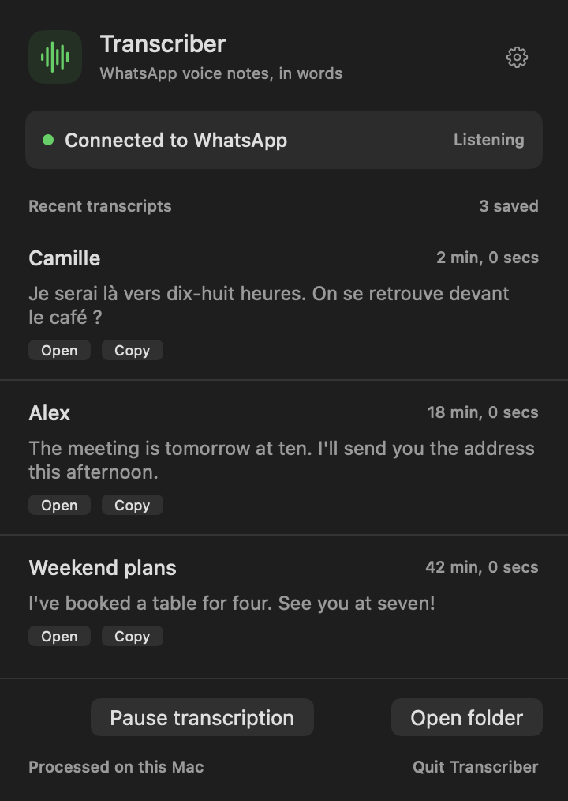

# WhatsApp Transcriber for Mac

A native menu bar app that automatically transcribes incoming WhatsApp voice notes and audio attachments. English and French are detected automatically. Whisper runs on your Mac, with no paid API or remote speech processing.

[Download the latest release](https://github.com/jdelaire/whatsapp-transcriber/releases/latest)

Apple Silicon, macOS 15 or later. The app bundles its tools and Python runtime, so Homebrew, Python and Terminal are not required to use it. The app is signed with Developer ID and notarized by Apple.



The screenshot uses sample data.

## Get started

1. Download `Transcriber-1.0.0-arm64.zip` from Releases, extract it and move `Transcriber.app` to Applications.
2. Open the app, then click the waveform in the menu bar.
3. Download the 488 MB speech model. The app checks its size and SHA-256 before using it.
4. Enter your WhatsApp number with its country code and request a linking code. On your phone, open WhatsApp, Settings, Linked devices, Link a device, Link with phone number. Enter the code shown by Transcriber.
5. Receive a voice note. Open or copy its transcript from the menu, or open the transcript folder.

Closing the menu keeps capture running. Pause is saved across launches. Quit stops capture and owned helper processes. Settings includes optional launch at login and notifications. Notification bodies do not contain message text or contact names.

An existing installation of the command-line receiver can be migrated without pairing again. The app preserves its model, linked account, queue, starting date and transcripts, and backs up the old startup configuration before taking over.

## Privacy and local files

WhatsApp linking and receiving messages require an internet connection. Speech processing stays on your Mac. No OpenAI API key or other paid transcription service is used.

Linked-device credentials, downloaded audio, the queue, model and rotating logs live in `~/Library/Application Support/WhatsAppTranscriber`. New standalone installations save transcripts in `~/WhatsApp Transcripts`. Personal runtime data is not included in the app or this repository. Linking codes are temporary and are not written to diagnostic logs.

The receiver uses wacli, an unofficial WhatsApp linked-device client. It retains a local message archive. Only received audio from the installation starting date is scheduled for automatic transcription; existing history is not bulk-transcribed. Initial linking requests up to one day of history and 100 messages per chat, subject to what the phone supplies.

## Limits and validation

- Speech recognition can mishear names, accents, noise and mixed-language recordings.
- Audio must have a known duration below 60 minutes. Decoded audio is limited to 120 MB. Other failures retry with saved state and bounded backoff.
- Sleep and network loss delay reception. A revoked link requires linking again. Media recovery depends on the phone retaining the recording.
- Runtime checks were performed on macOS 27.2 on Apple Silicon. macOS 15 deployment targets and dependencies were audited, but execution on macOS 15 remains untested.
- Native views were rendered and native Quit/relaunch was verified. Automated menu interaction was unavailable during validation. A fresh incoming note after the final app migration remains a manual check.

The application passed 58 Python tests and 7 Swift tests. Isolated bundle checks cover relocated tools, audio conversion, pairing shutdown, durable deduplication, parent loss, child cleanup and migration recovery. See the release verification file for the exact checks performed on each packaged build.

## Source and builds

`NativeApp` contains the SwiftUI menu and supervised process host. `app_engine.py`, `app_state.py` and `app_pairing.py` expose the local receiver through versioned JSON. `transcriber.py` contains capture, queue and transcription logic. `manage.py` retains the original command-line setup.

```sh
python3 -m unittest discover -s tests -v
swift test --package-path NativeApp --build-system native -j 4
```

The build uses pinned portable wacli, FFmpeg/ffprobe, Whisper.cpp and Python artifacts under `.build/portable`. Sanitized preparation inputs are in `build-support/portable`. Download the release's `Transcriber-SourceMaterials.zip` for upstream source, licenses, portable build scripts and the build manifest. Restore those artifacts as described in that archive, then run:

```sh
python3 scripts/build_app.py
```

The builder freezes the engine, compiles the native app, audits every Mach-O dependency and deployment target, signs nested helpers before the app, and packages source materials. It rejects personal build paths in the final bundle. Notarization and stapling require an Apple Developer ID and account access.

Bundled tools retain their upstream licenses. See [third-party materials](THIRD_PARTY.md). Keep the corresponding-source archive with the app when redistributing the bundled tools.
